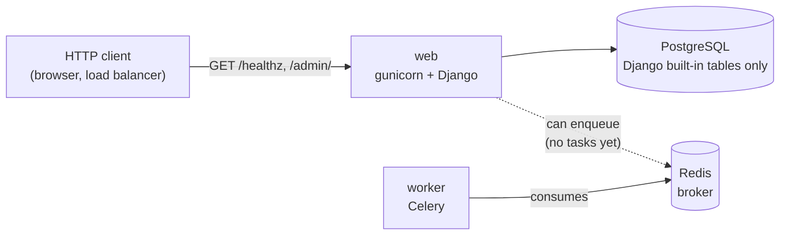

# Architecture (as implemented)

This document describes what exists in the repository **today**. It is not the
target design. Planned behavior lives in
[RFC 0001](../rfcs/0001-flaky-tracker-v1.md) (what and why) and
[`DESIGN.md`](../../DESIGN.md) (exact specs). Decisions and their status live
in [`docs/decisions/`](../decisions/README.md).

**Current stage:** project scaffold only. No GitHub integration, data model or
product behavior has been implemented yet.

## Status at a glance

| Component | Status | Where |
| --- | --- | --- |
| Django project (settings, URLs, WSGI) | Implemented | `config/` |
| Health check `GET /healthz` | Implemented | `core/views.py` |
| Django admin | Implemented (built-in models only) | `/admin/` |
| PostgreSQL connection | Implemented (no app models yet) | `DATABASE_URL` |
| Celery app with Redis broker | Implemented (no tasks) | `config/celery.py`, `config/settings.py` |
| Container image (gunicorn) | Implemented | `Dockerfile` |
| Local Postgres 18 and Redis 8 | Implemented | `docker-compose.yml` |
| CI: lint, format, types, migration check, tests, image build | Implemented | `.github/workflows/ci.yml` |
| JUnit XML fixtures | Implemented (no parser uses them yet) | `tests/fixtures/junit/` |
| GitHub App and LLM settings | Partial: read from the environment, unused | `config/settings.py` |
| Webhook endpoint and signature verification | Planned | — |
| Data model (installations, runs, results, comments) | Planned | — |
| GitHub API client | Planned | — |
| Artifact download and JUnit parsing | Planned | — |
| Flake detection and verdicts | Planned | — |
| PR comments | Planned | — |
| Recovery sweep for recorded runs | Planned | — |
| AWS infrastructure (Terraform) and deploys | Planned | no `infra/` directory yet |

## Runtime view



GitHub is not connected: there is no webhook route and no outbound API call.

**Processes** (one image for both):

- **web:** `gunicorn config.wsgi:application` with 2 workers on port 8000 (the
  image's default command). Locally: `manage.py runserver`.
- **worker:** `celery -A config worker`. It finds `tasks.py` modules in
  installed apps; none exist yet. On Windows it needs `--pool=solo`, under
  which Celery does not enforce task time limits.
- There is no scheduler process.

## Application structure

```text
config/
  settings.py   all settings, read from environment variables (.env in development)
  urls.py       /admin/ and /healthz
  celery.py     Celery app; reads CELERY_* Django settings; autodiscovers tasks
  __init__.py   loads the Celery app when Django starts, so views can enqueue tasks
  wsgi.py       entry point for gunicorn
core/
  views.py      healthz view
tests/
  test_health.py   /healthz responds, rejects POST
  test_setup.py    database reachable, no missing migrations, Celery reads Django settings
  fixtures/junit/  sample and malicious JUnit XML reports
manage.py
```

## Request flow

A request passes through Django's middleware in order: `SecurityMiddleware`
(HTTPS redirect and HSTS outside debug mode), WhiteNoise (serves collected
static files), sessions, CSRF, auth, messages and clickjacking protection, then
reaches a view.

`/healthz` returns `{"status": "ok"}` without touching the database or Redis.
It is a **liveness** check (the process is serving requests), not a
**readiness** check (its dependencies work).

## Persistence

- **PostgreSQL:** configured from `DATABASE_URL`. After `migrate`, it holds
  only Django's built-in tables (auth, admin, sessions, content types). The
  project has no models or migrations of its own. Primary keys default to
  `BigAutoField`.
- **Redis:** Celery broker only (`REDIS_URL`). No result backend is configured.
- **Static files:** collected into the image at build time and served by
  WhiteNoise.

## Background processing

Configured in `config/settings.py` and checked by `tests/test_setup.py`:

- `CELERY_TASK_ACKS_LATE = True`: a message is acknowledged after its task
  finishes, so a task interrupted mid-run can be delivered again.
- `CELERY_WORKER_PREFETCH_MULTIPLIER = 1`: a worker reserves one message at a
  time.
- `CELERY_TASK_TIME_LIMIT = 300`: hard limit in seconds.

Not configured yet: a soft time limit, the Redis `visibility_timeout` (Celery's
default of one hour applies), retries, any task, `on_commit` enqueueing and the
recovery sweep.

## External integrations

None are active. `GITHUB_APP_CLIENT_ID`, `GITHUB_APP_PRIVATE_KEY_PATH` and
`GITHUB_WEBHOOK_SECRET` are read but unused, and the GitHub App is not yet
registered. `LLM_API_KEY` and `LLM_MODEL` are read but unused.

## Security in place

- Secrets come from the environment; `.env` and `*.pem` are git-ignored.
  `DJANGO_SECRET_KEY` has no default, so the app refuses to start without one.
- `DEBUG` defaults to off. `ALLOWED_HOSTS` comes from the environment.
- Outside debug mode: HTTPS redirect (except `/healthz`), HSTS, secure session
  and CSRF cookies, and `X-Forwarded-Proto` trusted for a TLS-terminating load
  balancer.
- The container runs as a non-root user (uid 10001).
- Lint includes Ruff's `S` (security) rules; mypy runs in strict mode.
- `defusedxml` is installed, and fixtures for entity-expansion and external-
  entity attacks exist, but no code parses XML yet.

Not yet in place: webhook signature verification, request size limits and
`manage.py check --deploy` in CI.

## Reliability in place

- The Celery settings above (configured, not yet exercised by any task).
- `/healthz` for load balancer checks; health checks on the Compose services.
- CI on every pull request and on pushes to `main`: Ruff lint and format,
  mypy, a missing-migration check, pytest against Postgres 18, and a Docker
  build. `main` is protected and requires these checks.
- Reproducible installs from `uv.lock` (`uv sync --locked`).

## Known limitations

- Nothing user-facing works yet: the App can't be installed, receive events or
  post comments.
- No crash recovery exists, because no work is processed.
- No deployment: the image is built in CI but not pushed or run anywhere.
- `DESIGN.md` still describes RFC rev. 4. The RFC is a rev. 5 draft, and the
  two are reconciled during M0.

## Keeping this document current

Update it in the same pull request as any change to component
responsibilities, structure, data flow, persistence or deployment. Routine
changes inside a component don't need an update.
